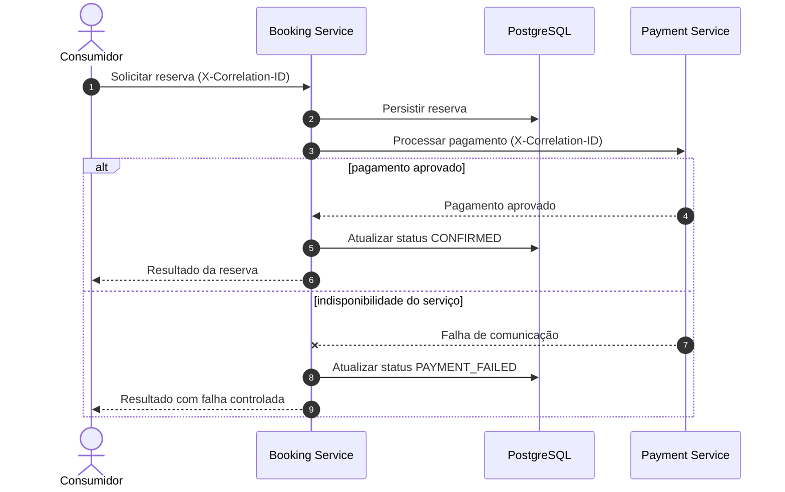
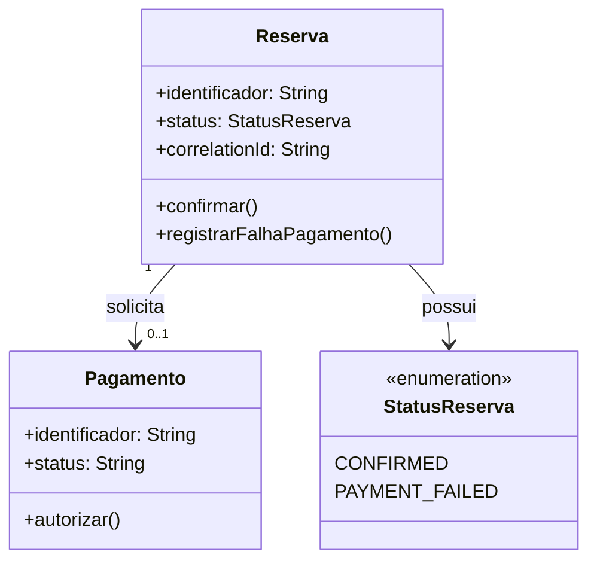
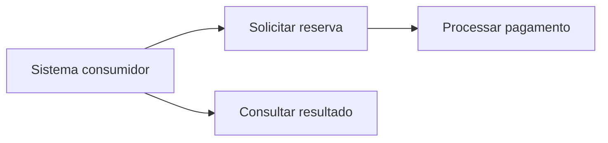

# Modelagem UML — Domínio de Reservas e Pagamentos

Documentação de análise de sistemas do laboratório de integração **Booking Service → Payment Service → PostgreSQL**.

## Escopo e premissas

- **Domínio:** criação de reservas, processamento de pagamentos e atualização de status.
- **Integrações:** comunicação HTTP entre Booking Service e Payment Service.
- **Persistência:** PostgreSQL.
- **Rastreabilidade:** propagação de `X-Correlation-ID`.
- **Comportamento de falha:** indisponibilidade do pagamento preserva a reserva com status `PAYMENT_FAILED`.

Os diagramas representam o comportamento documentado do laboratório. O modelo de classes é **conceitual**: seus atributos e métodos não devem ser interpretados como nomes de classes Java existentes sem verificação no código.

## 1. Interações entre serviços — diagrama de sequência

### Regras de negócio e integridade

| Regra | Comportamento esperado | Evidência de validação |
|---|---|---|
| RN-01 | Reserva persistida no fluxo de integração | Consultas/validações do laboratório |
| RN-02 | Pagamento aprovado resulta em `CONFIRMED` | Cenário de integração Booking/Payment |
| RN-03 | Indisponibilidade do Payment resulta em `PAYMENT_FAILED` | Cenário de falha controlada |
| RN-04 | `X-Correlation-ID` é propagado entre serviços | Validação de cabeçalhos e logs |

A correspondência exata com casos de teste e endpoints deve ser conferida antes de declarar rastreabilidade completa.

## 2. Modelo de domínio — diagrama de classes conceitual

### Decisões de modelagem

- **Reserva** concentra o estado do processo de negócio.
- **Pagamento** representa a interação necessária para confirmar a reserva.
- **StatusReserva** explicita os estados relevantes para os cenários documentados.
- A associação entre reserva e pagamento é uma **hipótese conceitual** de análise; cardinalidades, atributos e operações exigem validação contra a implementação antes de se tornarem especificação técnica definitiva.

## 3. Visão funcional do processo

Esta é uma visão funcional em fluxograma, **não** um diagrama UML formal de casos de uso.

## 4. Análise de impacto

Uma alteração no contrato de pagamento pode afetar:
1. comunicação entre os serviços;
2. tratamento de indisponibilidade;
3. transição dos estados `CONFIRMED` e `PAYMENT_FAILED`;
4. persistência e consistência dos dados;
5. rastreabilidade distribuída por `X-Correlation-ID`;
6. testes de integração, contrato e regressão.

## Referências internas

- [Arquitetura](../architecture.md)
- [Estratégia de testes](../test-strategy.md)
- [Conceitos de referência](./INTERVIEW-CHEATSHEET.md)

Os diagramas Mermaid são renderizados diretamente pelo GitHub. O documento descreve o domínio e a arquitetura do laboratório; não representa certificação UML nem experiência profissional específica com ferramentas CASE.
