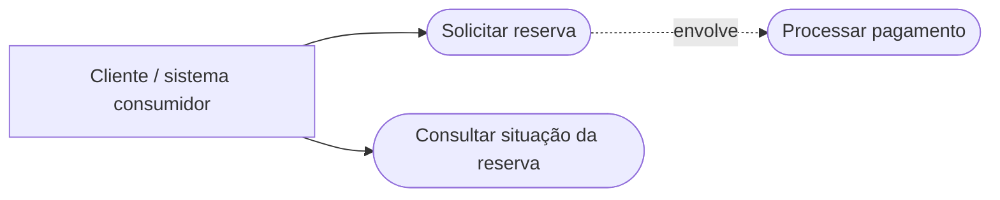
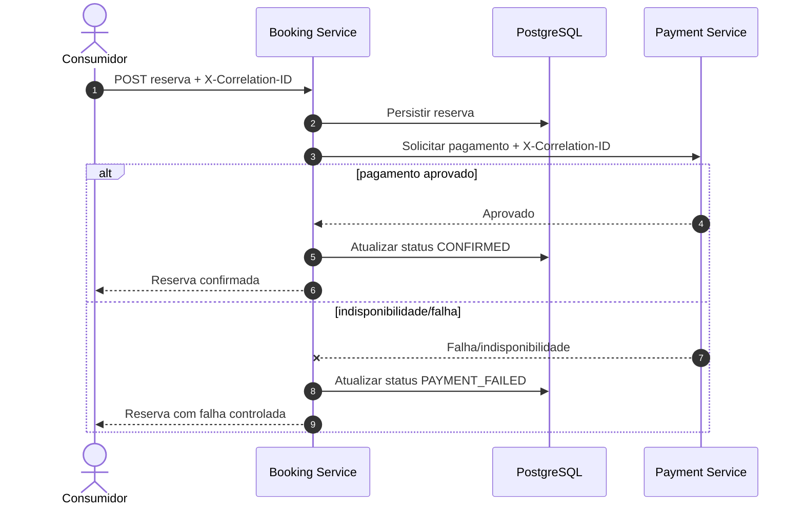
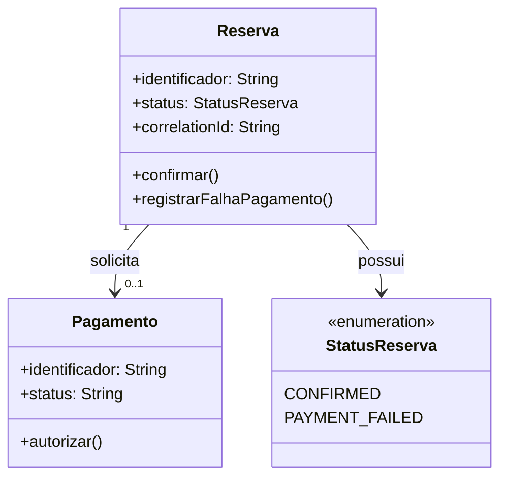

# UML e orientação a objetos — laboratório Booking / Payment

> Material de estudo e documentação **conceitual** baseado no laboratório de integração deste repositório. Diagramas são modelos didáticos, não engenharia reversa completa do código. Sem alterar produção, testes ou infraestrutura.

## O que é UML?

UML (Unified Modeling Language) é uma **linguagem de modelagem**, não um programa. Pode ser desenhada no Miro, diagrams.net/draw.io ou renderizada a partir de texto Mermaid no GitHub. Ferramentas CASE apoiam atividades de modelagem e engenharia de software; usar Miro não comprova, por si só, experiência com uma ferramenta CASE especializada.

## 1. Caso de uso: visão de negócio

**Leitura:** mostra capacidades do sistema, não detalhes de implementação. É uma representação didática de casos de uso; o desenho é um fluxograma Mermaid, **não** um diagrama UML formal de casos de uso com notação completa.

## 2. Diagrama de sequência UML: fluxo de reserva

**Perguntas:** quem inicia a chamada? Onde ocorre persistência? O que acontece quando o Payment Service falha? Como rastrear o mesmo pedido entre serviços?

## 3. Diagrama de classes UML — modelo conceitual (não classes Java confirmadas)

**Atenção:** os atributos e métodos acima são **proposta de modelagem didática**, não uma afirmação de que existem com esses nomes no código-fonte. Verifique classes e persistência reais antes de transformar o modelo em documentação de implementação.

## 4. Conceitos rápidos de orientação a objetos

| Conceito | Explicação | Exemplo didático |
|---|---|---|
| Classe | Molde que define dados e comportamentos | `Reserva` |
| Objeto | Instância concreta de uma classe | Reserva `R-123` |
| Atributo | Informação mantida pelo objeto | `status` |
| Método | Operação/comportamento | `confirmar()` |
| Encapsulamento | Protege estado e expõe operações controladas | Alterar status por método validado |
| Abstração | Representa apenas o essencial | `Pagamento` sem detalhes do provedor |
| Herança | Uma classe especializa outra | `PagamentoPix` herda de `Pagamento` (hipotético) |
| Polimorfismo | Implementações diferentes respondem ao mesmo contrato | `autorizar()` em formas de pagamento distintas (hipotético) |
| Associação | Relação entre objetos | Reserva se relaciona com Pagamento |
| Composição | Parte depende do ciclo de vida do todo | Exemplo genérico: Pedido contém ItensPedido |

**Importante:** microserviços, endpoints REST e tabelas não são automaticamente classes. O diagrama de sequência modela interações; o de classes modela estrutura conceitual.

## 5. Exercício para fixar (15 minutos)

1. Explique em voz alta por que a reserva é persistida antes da chamada ao pagamento.
2. Desenhe no Miro a sequência do cenário `PAYMENT_FAILED`.
3. Diferencie atributo `status` e método `confirmar()`.
4. Diga quais elementos do diagrama de classes precisariam ser conferidos no código.
5. Compare UML (modelagem de software), BPMN (processos de negócio) e Figma (interfaces).

## Como visualizar

O GitHub renderiza os blocos Mermaid automaticamente no Markdown. Abra este arquivo no repositório e selecione a visualização renderizada. Não é preciso instalar ferramenta para começar.

## Como apresentar no currículo/LinkedIn

Formulação segura: **"Estudo aplicado de UML e orientação a objetos: documentação conceitual de fluxos de reserva e pagamento com diagramas de sequência e classes, vinculada a laboratório de APIs e microserviços."**

Não declarar experiência profissional com Oracle, UML, CASE ou BPMN sem evidência correspondente.
